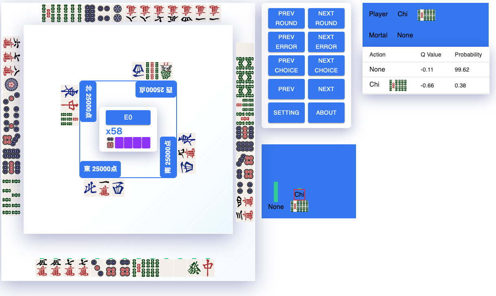
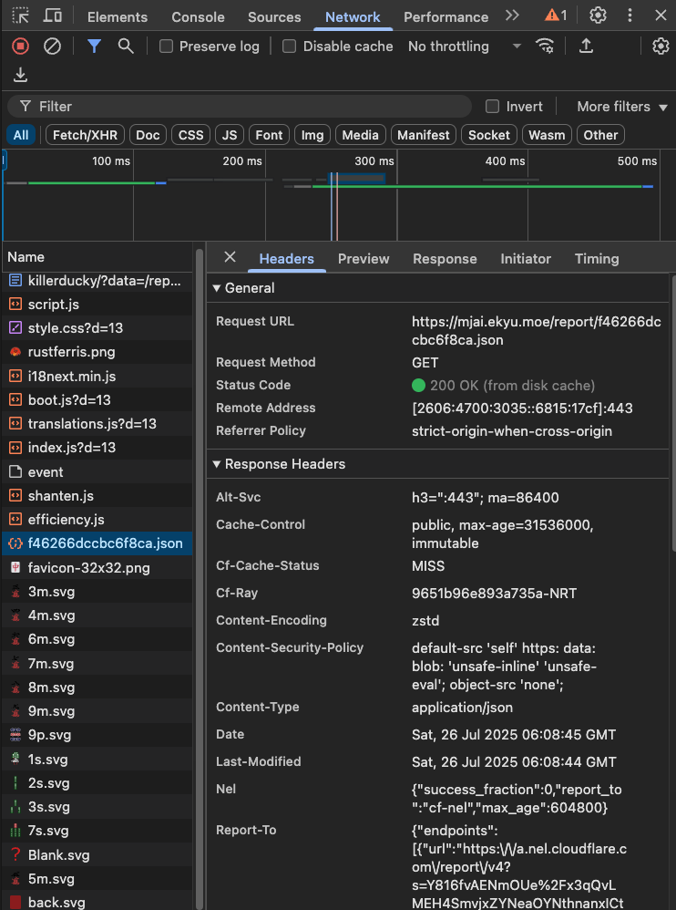

# Mortal Lens

Another alternative to review Mahjong Games.



## How to use

### Browser Extension

The browser extension automatically detects Mortal AI review pages and opens the analysis view.

**Supported Browsers:** Chrome, Firefox

#### Install

The extension is distributed as a packaged release from this repository.

- **Chrome:** Download the `.zip` file, extract it, then go to `chrome://extensions`, enable "Developer mode", and click "Load unpacked" to select the extracted folder.
- **Firefox:** Download the `.xpi` file, then go to `about:addons` and install from file.

#### Usage

1. Install the extension
2. Go to any review page on https://mjai.ekyu.moe
3. The extension automatically detects the page and opens the analysis view in a new tab

You can also click the extension icon to see the current status and manually trigger analysis with the "Analyze Current Page" button.

### Web App

You can also use the standalone web app by running it locally.

1. Review any game using Mortal AI
   https://mjai.ekyu.moe
2. Open JSON from the review page from the Network tab in developer tool
   Download it by copying the file to your local PC
   
3. Upload the JSON from the web app
   

## Development

### Prerequisites

To build the application pnpm is required. Read the installation [here](https://pnpm.io/ja/installation) if you haven't installed it.

This application also has external dependency that is not published to npm. You need to prepare these packages locally.
Clone the below 2 repos.

```git
git clone https://github.com/SakaiTaka23/mjai-ts.git
git clone https://github.com/SakaiTaka23/riichi-mahjong-tiles.git
```

These repos should be at the same folder as this repo.

```
.
├── mjai-ts
├── mortal-lens
├── riichi-mahjong-tiles
```

Also build those repos as well.

```shell
cd mjai-ts
pnpm build
cd ../
cd riichi-mahjong-tiles
pnpm build
```

### Setup

Install dependencies. Note: `pnpm install` may show a warning from the extension's `postinstall` (`wxt prepare`) because workspace packages are not yet built at this point. This is expected and does not affect the install.

```shell
pnpm install
```

Build all packages in this repo. Execute the below command at the top level of this repo.

```shell
pnpm build
```

### Run the Web App

```shell
pnpm preview
```

Access the app http://localhost:4173

### Build the Extension

```shell
# Chrome
cd app/extension
pnpm build

# Firefox
pnpm build:firefox
```

The build output will be in `app/extension/dist/chrome-mv3/` or `app/extension/dist/firefox-mv2/`.

To create distribution zip files:

```shell
pnpm zip            # Chrome
pnpm zip:firefox    # Firefox
```
